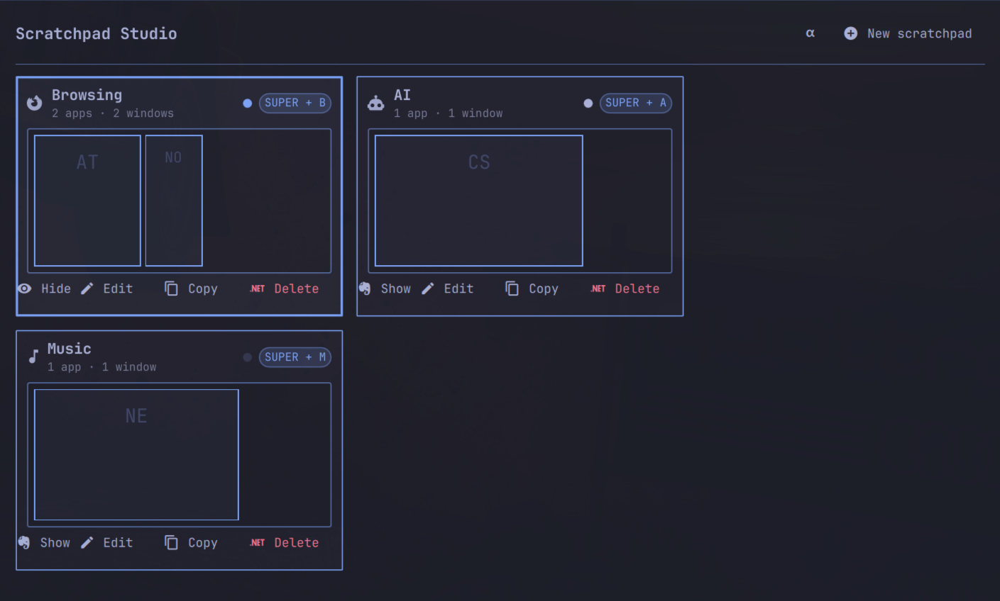
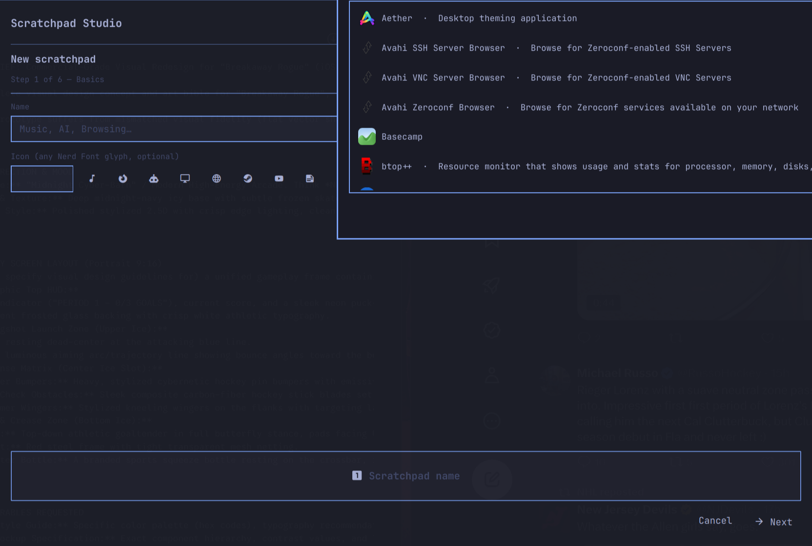
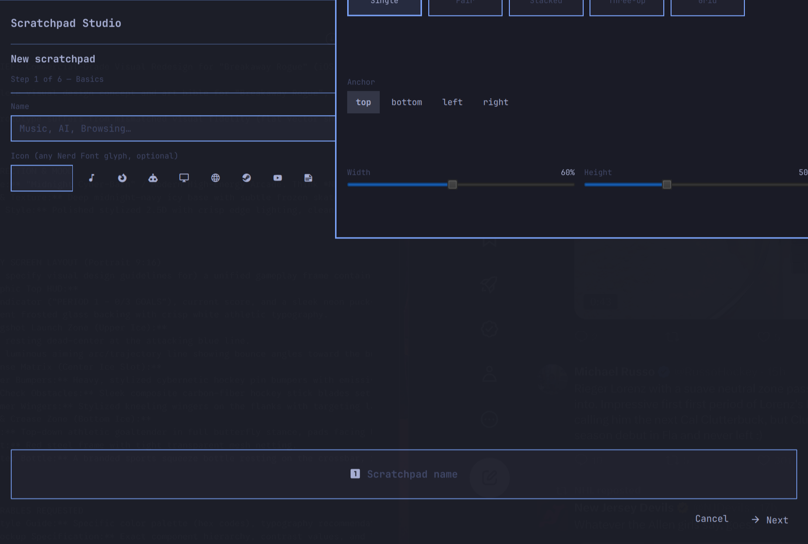
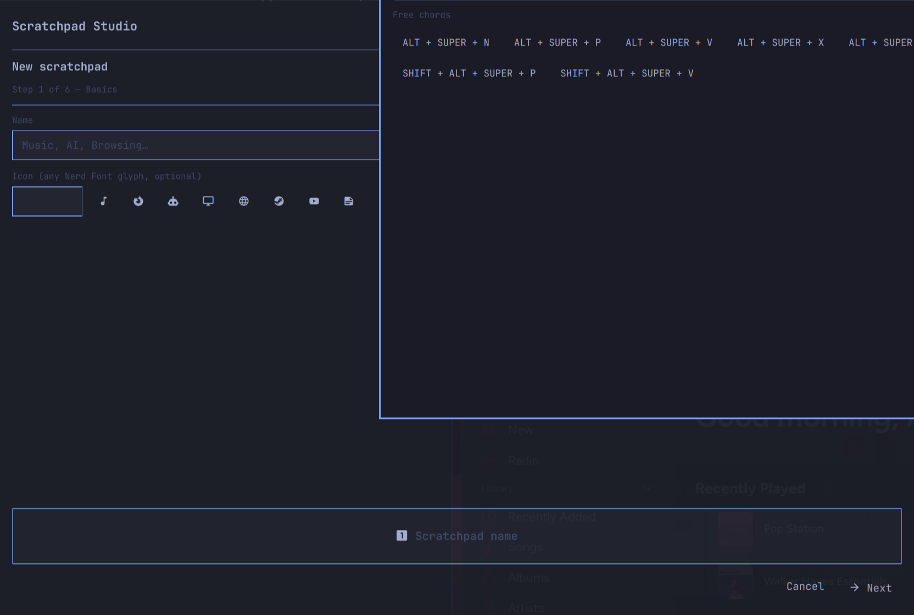
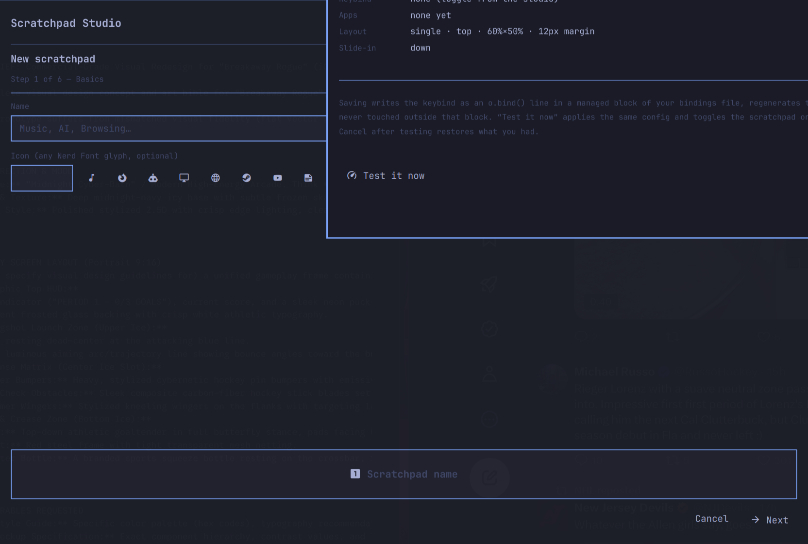
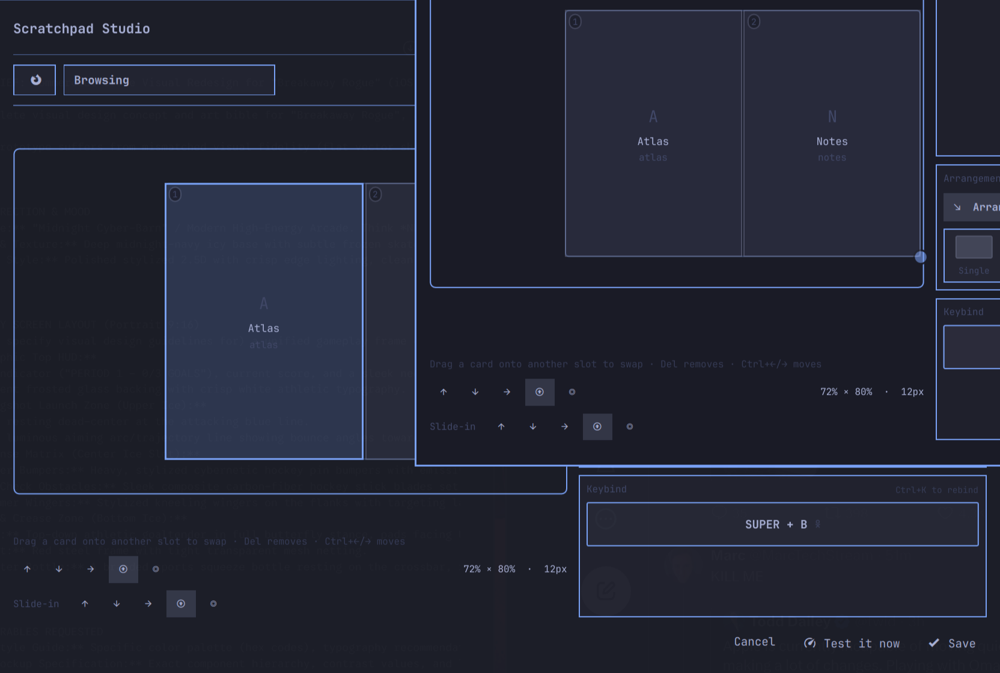
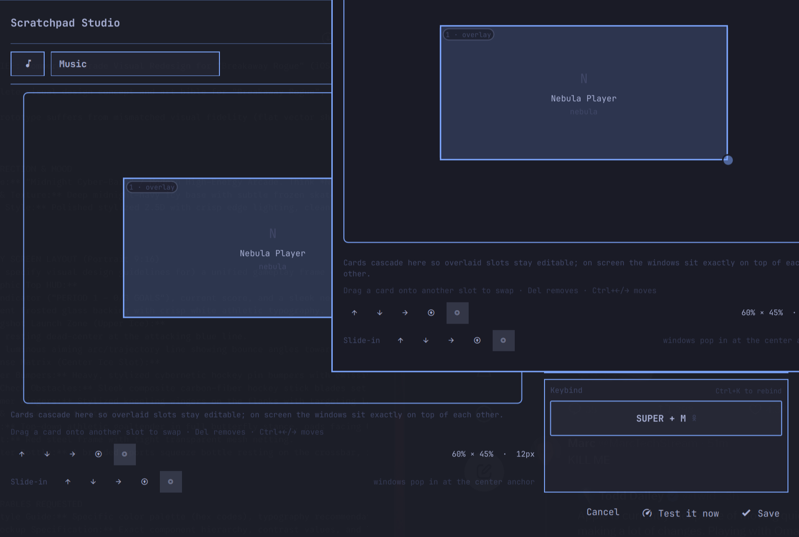

# Scratchpad Studio

An [Omarchy](https://omarchy.org) bar plugin for people who want more than
one scratchpad. See every scratchpad with a live schematic of its windows,
create new ones from installed apps, pick layouts and slide-in anchors,
bind chords with conflict checking — and toggle them all without ever
touching a config file.

A scratchpad is a named set of windows living on its own Hyprland special
workspace: press its chord and it slides in, press again and it hides.
Browsing, AI, music — one chord each.



## Features

- **Overview grid** — one card per scratchpad: name, keybind chip, status
  dot (shown / hidden / empty), and a live, to-scale schematic of the real
  window rectangles inside it, with app icons. Existing `special:*`
  workspaces you already had show up too and can be adopted.
- **Visual layout editor** — click Edit on any scratchpad and get its
  windows drawn in their saved arrangement on a monitor-true canvas.
  Drag a card onto another's **edge** to split (drag a window to the
  right and the other fills the left), onto the middle to swap
  (Ctrl+←/→ works too), Del removes an app, **Add app** reuses the
  wizard's picker (installed apps, running windows, custom command/URL).
  Click the size numbers for width/height/margin sliders, or drag the
  frame's corner handle. The keybind is an editable control — click the
  chip or Ctrl+K, hold modifiers in any order (they build up live),
  press the final key, done; a chord that's already taken blocks saving
  until you pick a free one. Saving swaps the old `o.bind()` line for
  the new one wholesale (no orphan binds) and reflows already-open
  windows onto their new slots, live. Windows can be arranged in slots
  or set to float freely, anchored to any edge or the center (a
  centered scratchpad pops in).
- **Six-step wizard** — name & icon; apps picked from installed apps,
  currently-running windows, or a custom command/URL (web apps open as
  `chromium --app` windows with the right class); window placement
  (arranged in slots or floating), layout thumbnails
  (single / pair / stacked / three-up / grid) with size, anchor and margin;
  slide-in direction (or centered pop-in) with an animated preview;
  press-to-capture keybind with live conflict detection and free-chord
  suggestions; review with a **Test it now** button that applies and
  toggles the real thing before you commit.

| | |
|---|---|
|  |  |
|  |  |



Editing the centered Music scratchpad — anchor and slide-in live under the
canvas; the pair arrangement, apps and keybind sit on the right:



- **Two surfaces** — the panel from the bar icon, and a resizable app
  window (right-click the bar icon, `ipc call scratchpad-studio window`,
  or the ⌗ button in the panel header).
- **Keyboard-first** — arrows move the grid cursor, Enter toggles,
  `n` starts a new scratchpad, Esc closes; the wizard advances with Enter
  and steps back with Esc.
- **Native engine, no daemon** — see below.

## Install

```sh
omarchy plugin add <this repo's git url> --enable
```

Then click the Scratchpad Studio icon in the bar (or bind
`omarchy-shell shell toggle scratchpad-studio`). The first scratchpad you
create wires everything up: the plugin writes exactly one managed block
into `~/.config/hypr/bindings.lua` and one generated file,
`~/.config/hypr/scratchpad-studio.lua`, and reloads. Screenshots above use
demo mode (`ipc call scratchpad-studio demo on`) — fake scratchpads, fake
titles.

## How the engine works (and why not pyprland)

Scratchpad Studio manages **named special workspaces** natively:

- Each scratchpad's apps get Hyprland window rules that route their window
  class into `special:<name>` silently, floating, with pixel geometry
  baked from your monitor (window-rule `size`/`move` ignore percentages —
  verified on Hyprland 0.56.2). Scratchpads set to **floating** placement
  skip the size/move rules: windows open at their own size and stay where
  you put them.
- Editing is not config-only: `upsert` reflows windows that are already
  open onto their new slots (float → resize → move, works even while the
  scratchpad is hidden), and removing an app relocates its live windows to
  your current workspace — nothing is ever closed or killed.
- Its chord runs `scratchpad-studio toggle <name>`: any app whose class
  isn't already on the scratchpad's workspace is launched (rules route it
  in), then the special workspace is revealed — and slots-placement
  windows are reflowed onto their configured rects, so a scratchpad
  always lands in its saved arrangement even if a window was dragged
  away or tiled. Single-instance apps (Cider, Discord, …) match by class
  with no process tracking, so launchers that exit immediately still
  work; web apps match their `chrome-<host>__-Default` class.
- Every scratchpad owns its own `special:<id>` workspace, and ids are
  unique — `special:scratchpad` is Omarchy's built-in (your SUPER+S
  toggles it), so the plugin never assigns that id; a scratchpad named
  "Scratchpad" simply becomes `special:scratchpad-2`. No two
  scratchpads ever share a workspace, so chords never cross wires.
- Keybinds are `o.bind()` lines in the generated file, included from a
  clearly-marked managed block in `bindings.lua`. The file is regenerated
  from state on every save, so a changed chord replaces the old line —
  there are no orphan binds.

pyprland was evaluated first and rejected: it is not packaged for stock
Omarchy, and its `hyprctl dispatch <string>` control surface fails under
Hyprland's Lua config (`hl.dispatch: expected a dispatcher`). Everything
it would do here is available natively. Full decision record in
[docs/design.md](docs/design.md).

Known simplification: the reveal slide is Hyprland's global
special-workspace animation; the wizard's "slide in from" choice steers
anchor + per-window animation so the scratchpad enters the way it sits
(the centered pick anchors center and pops in).

## Files it writes

| Path | What |
|---|---|
| `~/.config/hypr/scratchpad-studio.lua` | generated rules + binds (plugin-owned) |
| `~/.config/hypr/bindings.lua` | one managed block: `require("hypr.scratchpad-studio")` |
| `~/.config/scratchpad-studio/scratchpads.json` | your scratchpads (source of truth) |
| `~/.config/scratchpad-studio/backups/` | timestamped copies made before every write |

Backups before every write, idempotent regeneration, `hyprctl
configerrors` validated after each reload (bad config rolls back
automatically), and geometry regenerates when monitors change.

## Uninstall

One command, zero residue:

```sh
~/.config/omarchy/plugins/scratchpad-studio/bin/scratchpad-studio uninstall
omarchy plugin remove scratchpad-studio
```

That removes the managed block, the generated file, and reloads — windows
that lived in scratchpads are left open on your current workspace, never
closed. Add `--purge` to also delete the state file and backups.

## Development

```sh
python3 -m unittest discover -s tests   # geometry, generation, conflicts,
                                         # catalogue, editing (placement,
                                         # reflow, bind replacement)
```

`bin/scratchpad-studio` (Python stdlib, no deps) is the engine;
`lib/*.js` are pure functions shared with the QML views; theme colors and
spacing come from the Omarchy shell singletons, so the plugin re-themes
with your setup. See [AGENTS.md](AGENTS.md) for the constraint list and
the live-machine caveats (QML edits need a shell restart to register IPC;
`hyprctl eval` lacks keybind context — use `hyprctl dispatch`).

## License

MIT
